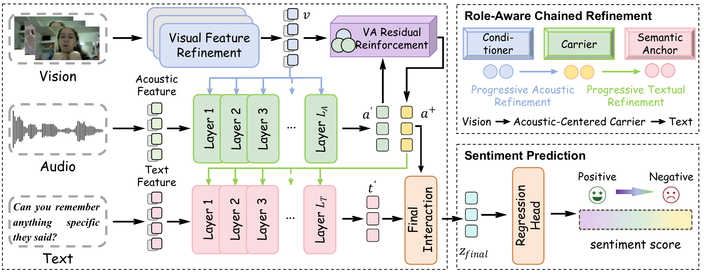

<div align="center">

<h1>RPCR</h1>

<h3>Role-Aware Progressive Chained Refinement<br>for Multimodal Sentiment Analysis</h3>

<p>Xiaoran Kou · Dingkang Yang · Jingyi Wu · Jing Qian · Peng Sun · Yang Liu · Hong Chen</p>

<p>
  <a href="https://github.com/ma-tubu/RPCR"></a>
  
  
  
</p>

<p>
  <a href="#overview">Overview</a> ·
  <a href="#quick-start">Quick start</a> ·
  <a href="#training">Training</a> ·
  <a href="#evaluation">Evaluation</a> ·
  <a href="#project-structure">Project structure</a> ·
  <a href="#citation">Citation</a>
</p>

</div>

<p align="center">
  
  <br>
  <sub>Overview of the RPCR framework.</sub>
</p>

---

## Overview

RPCR organizes multimodal sentiment evidence along a **Vision → Audio → Text** chain.
Visual cues progressively refine an acoustic carrier, which then calibrates the textual
semantic anchor for sentiment prediction.

<table>
  <tr>
    <td width="33%" valign="top">
      <strong>Role-aware organization</strong><br>
      Vision conditions, audio carries nonverbal evidence, and text anchors semantics.
    </td>
    <td width="33%" valign="top">
      <strong>Progressive refinement</strong><br>
      Each transition updates its target through successive conditional refinement layers.
    </td>
    <td width="33%" valign="top">
      <strong>Adaptive correction</strong><br>
      Refinement is regulated at the sample, layer, and feature levels.
    </td>
  </tr>
</table>

## Quick start

```bash
git clone https://github.com/ma-tubu/RPCR.git
cd RPCR
pip install -r requirements.txt
```

Requires **Python 3.10+** and **PyTorch 2.5+**.

## Training

Train using a prepared feature cache and an experiment configuration:

```bash
python train.py \
  --config configs/cmumosei.json \
  --cache-path cache/cmumosei_full.pt \
  --output-dir runs/cmumosei \
  --device cuda
```

| Configuration | Settings |
|---|---|
| [`configs/cmumosi.json`](configs/cmumosi.json) | CMU-MOSI model and optimization parameters. |
| [`configs/cmumosei.json`](configs/cmumosei.json) | CMU-MOSEI model and optimization parameters. |
| [`configs/chsims.json`](configs/chsims.json) | CH-SIMS model and optimization parameters. |

Command-line arguments override configuration values.

The test split is evaluated after validation-based checkpoint selection.
Use `--monitor Acc_3` for CH-SIMS and `--monitor MAE` for CMU-MOSI/MOSEI.
Training options are available through `python train.py --help`.

## Evaluation

Evaluate a saved checkpoint independently of training:

```bash
python evaluate.py \
  --checkpoint runs/cmumosei/best.pt \
  --cache-path cache/cmumosei_full.pt \
  --output runs/cmumosei/evaluation.json \
  --device cuda
```

The model configuration and output activation are loaded from the checkpoint.
Use `--split valid` to evaluate the validation split.

## Project structure

```text
RPCR/
├── models/
│   ├── adapters.py             # Input adapters and residual FFN blocks
│   ├── refinement.py           # Conditional refinement
│   ├── losses.py               # Training objectives
│   └── rpcr.py                 # Chained architecture and prediction
├── configs/
│   ├── cmumosi.json
│   ├── cmumosei.json
│   └── chsims.json
├── utils/
│   ├── configuration.py        # Configuration and command-line options
│   ├── checkpoint.py           # Checkpoint saving and loading
│   ├── engine.py               # Training and evaluation steps
│   ├── feature_cache.py        # Cache construction
│   ├── feature_dataset.py      # Feature cache loading
│   └── regression_metrics.py   # Sentiment evaluation metrics
├── tools/
│   ├── build_feature_cache.py
│   └── inspect_features.py
├── assets/
│   └── images/
│       └── architecture.png
├── train.py                    # Training entry point
├── evaluate.py                 # Checkpoint evaluation
├── requirements.txt
└── README.md
```

Feature-cache utilities are available through
`python tools/build_feature_cache.py --help` and `python tools/inspect_features.py --help`.

## Citation

If you use this code, please cite:

```bibtex
@misc{kou2026rpcr,
  title  = {RPCR: Role-Aware Progressive Chained Refinement
            for Multimodal Sentiment Analysis},
  author = {Kou, Xiaoran and Yang, Dingkang and Wu, Jingyi and
            Qian, Jing and Sun, Peng and Liu, Yang and Chen, Hong},
  year   = {2026},
  url    = {https://github.com/ma-tubu/RPCR}
}
```

## Contact

- **Xiaoran Kou:** [2451806@tongji.edu.cn](mailto:2451806@tongji.edu.cn)
